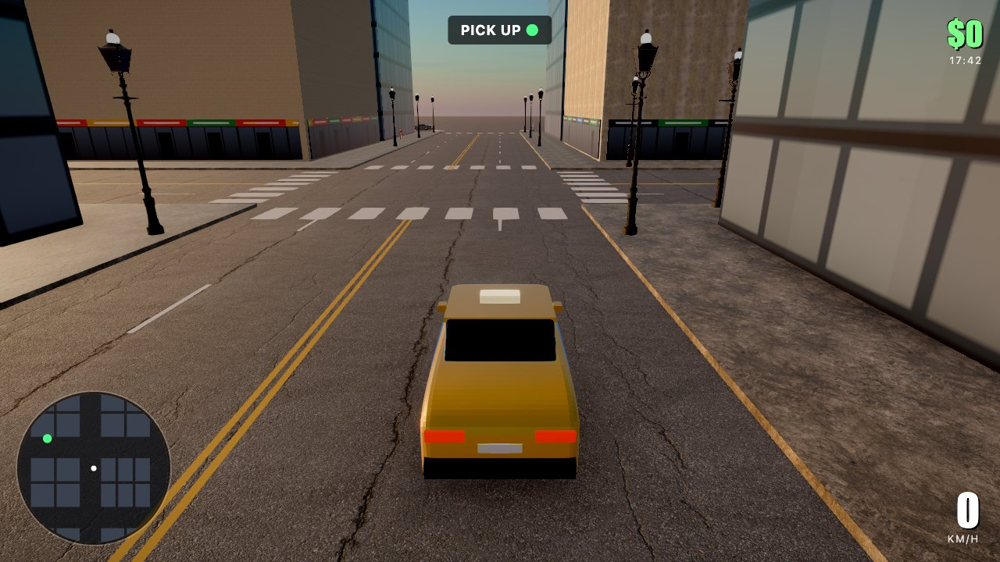

# Game Forge

**Vibe-code browser games with Claude Code.** Describe a game in plain English, and Claude builds it, playtests it headlessly, and hands you something playable in a single session.

Everything is set up for an AI agent to work fast: a shared game kit (juice, procedural art & sound, menus, AI helpers), six genre templates that already play, a headless bot that plays your game and screenshots it, and instructions (`AGENTS.md` / `CLAUDE.md` / skills) that teach the agent how to use all of it.

| | |
|---|---|
|  |  |
| **Neon Swarm** — twin-stick roguelite (2D, Phaser) | **Block Racer** — voxel drift racer (3D, Three.js) |
|  |  |
| **Hollow House** — first-person horror (3D, Three.js) | **The arcade** — every game you make shows up here |
|  | |
| **Sunset District** — realistic GTA-style city: traffic, people, golden hour → night (3D, Three.js) | |

All games were built by Claude in this repo from short prompts, using the shared kit and the CC0 asset library below.

## Game Forge Studio (desktop app, no setup)

For people who don't use a terminal: a Mac app laid out like Cursor — games on the left, the live game in browser-style tabs in the middle, and the Claude Code agent on the right.

- **One download:** `npm run studio:build` makes `dist-studio/Game-Forge-Studio.dmg` (~380 MB). It bundles the game tools, the asset library and every library, and runs on its own built-in Node, so the person you send it to doesn't install Node, npm or git.
- **Uses their own Claude Code:** the setup screen installs Claude Code with Anthropic's official installer and signs in through Claude's own sign-in page. The app never sees or stores Claude credentials, it just runs `claude` on their machine with their plan (Pro or Max).
- **Making games:** "New game" → describe it → Claude Code builds it and the preview appears. Ask for changes in plain words; click a quick-fix to apply a kid-check fix; "Export for itch.io" makes the zip.
- Games live in `~/Game Forge/games`. Try the app from this repo with `npm run studio`.
- Not yet: Windows build, and an Apple Developer ID signature. Until it's signed and notarized, people right-click the app → Open the first time.

## Asset library


**Thousands of 3D models, hundreds of photoscanned PBR materials and HDRI skies, realistic people with motion capture, ~1,900 sprites, ~670 sounds** — free for commercial use, from [Kenney](https://kenney.nl), [KayKit](https://kaylousberg.com), [Poly Haven](https://polyhaven.com), [ambientCG](https://ambientcg.com) (CC0) and [Microsoft Rocketbox](https://github.com/microsoft/Microsoft-Rocketbox) (MIT). Exact counts: `assets/CATALOG.md`.

- Browse it at **`/assets.html`** (link on the arcade page): search, spin models in 3D, play their animations, listen to sounds, copy names.
- Claude reads `assets/CATALOG.md` and uses the library automatically when it builds a game.
- **Realistic games:** a built-in realism stack (sky + sun, soft shadows, ambient occlusion, bloom, filmic tone mapping, day/night), a procedural city and procedural cars — see `games/sunset-district`, a GTA-style city demo.
- Need something else? `npm run assets -- add <kenney-pack>`, `kaykit <pack>`, `model|texture|hdri <polyhaven-id>`, `ambientcg <id>`, `rocketbox`, or `npm run assets -- texture <polyhaven-id>` pulls it in, ready to use.

## Quick start

Requires **Node 20.19+** and, for the AI workflow, **[Claude Code](https://claude.com/claude-code)** (CLI, VS Code or JetBrains extension, or desktop app).

```bash
git clone https://github.com/npmiaman/game-forge.git
cd game-forge
npm run setup          # installs dependencies + headless Chromium for playtests
npm run dev            # opens the arcade at http://localhost:5173
```

Then open the folder in Claude Code and say what you want:

> *make a game where you're a bee defending a hive from wasps, with roguelite upgrades*

Claude picks the closest template, scaffolds `games/<your-game>/`, builds it, bot-playtests it, reads the screenshots, fixes what's broken, and tells you how to play it.

Then it runs a **kid check**: it plays the game the way a kid would, lists the **5 things anyone would say look wrong** (*"the sky is just one boring blue"*, *"the lights are just white boxes"*), and has a small, tested fix for each one staged as a patch. Say *"fix 2"* or *"fix all"* and it lands instantly — see [games/blast-ball/FIXES.md](games/blast-ball/FIXES.md) for an example.

## The vibe-coding loop

1. **Describe it.** Any genre: shooter, platformer, puzzle, physics, racing, 3D, horror…
2. **Play it.** `npm run play -- <slug>` opens it with hot reload.
3. **Tune it live.** Add `?tune` to the URL for sliders on every gameplay number. Hit *Copy values* and paste them back to Claude.
4. **Iterate in plain words.** *"enemies feel floaty"*, *"add a boss at wave 5"*, *"make the jump snappier"*.
5. **Polish & ship.** `/polish <slug>` runs a game-feel pass; `/ship <slug>` makes an itch.io-ready zip.

Each game keeps a `GAME.md` design doc that Claude reads and updates, so you can come back days later and say *"continue the bee game"*.

### Claude Code commands

| Command | What it does |
|---|---|
| *"make me a … game"* | `make-game` skill: design → scaffold → build → playtest → hand-off |
| `/playtest <slug>` | bot-plays the game, reads screenshots, fixes what's broken |
| `/polish <slug>` | walks the game-feel checklist and adds missing juice |
| `/ship <slug>` | checks, builds, and zips the game for itch.io |
| *"fix 2"* / *"fix all"* | applies the staged kid-check fixes (`games/<slug>/FIXES.md`) |

A hook type-checks after every edit Claude makes and feeds errors straight back, so broken code never piles up.

## Commands

| | |
|---|---|
| `npm run new` | list templates and existing games |
| `npm run new -- my-game --template topdown` | new game from a template |
| `npm run new -- my-game --from neon-swarm` | remix an existing game |
| `npm run play -- my-game [god&tune]` | dev server + open the game |
| `npm run shot -- my-game --gpu` | headless bot playtest → screenshots in `.shots/` |
| `npm run check` | type-check everything (~1 s) |
| `npm run ship -- my-game` | standalone build + `ship/my-game.zip` |
| `npm run assets -- add castle-kit` | import any Kenney pack (also `texture` / `hdri <polyhaven-id>`) |
| `npm run fixes -- apply my-game 2` | apply a staged kid-check fix (`undo`, `list`, `all` too) |
| `npm run build` | the whole arcade as a static site in `dist/` |

VS Code users: **Tasks: Run Task** has all of these, and **F5** debugs a game in Chrome with breakpoints.

## Templates

| Template | Start here for |
|---|---|
| `blank` | anything 2D that fits nothing below |
| `topdown` | shooters, survivors-likes, lots of enemies, level-up cards |
| `platformer` | platformers, side-scrollers (coyote time, ASCII levels) |
| `puzzle` | grid / turn-based / logic games (Sokoban with undo) |
| `physics` | real rigid bodies: slingshots, stacking, golf (Matter.js) |
| `3d` | anything 3D (Three.js with bloom and HTML HUD) |

Every template is a complete, playtested game — menus, pause, game over, best score, sound and juice included.

## What's inside

```
assets/         CC0 asset library (models, sprites, sounds, textures, skies) + CATALOG.md
kit/            shared game kit — every file's header comment is its docs
  audio.ts        procedural SFX presets (ZzFX) + chiptune/synthwave music sequencer
  tune.ts         live tuning sliders (?tune)
  director.ts     wave / spawn budgeting      upgrades.ts   roguelite "pick 1 of 3"
  grid.ts         A* pathfinding, flood fill  fsm.ts        state machines
  pool.ts · spatial.ts · rng.ts · save.ts · math.ts · input.ts
  phaser/         boot, menus, pause, upgrade cards, procedural textures, juice, UI, touch
  three/          boot (renderer, bloom, shadows, HUD, shake), cube debris
  assets.ts       load library models/animations/textures/skies/sounds by name
templates/      six genre starters
games/          your games (each: index.html, main.ts, game.json, GAME.md)
scripts/        new-game, play, shot (headless playtest), fixes (staged patches), ship, assets (importer CLI)
  importers/      one module per asset source (Kenney, KayKit, Poly Haven, ambientCG, Rocketbox) + catalog
  lib/            shared helpers (paths, CLI flags, type-check, Vite + Chromium)
studio/         Game Forge Studio desktop app (main.mjs + main/: env, workspace, games, Claude chat runner, ui)
  ui/             its Next.js interface (tabs, browser preview, agent panel)
.claude/        skills (make-game, kid-check, playtest, polish, ship, phaser4) + type-check hook
AGENTS.md       instructions for any coding agent (CLAUDE.md imports it)
```

**Stack:** Phaser 4 · Three.js · Vite · TypeScript · ZzFX · Tweakpane · Playwright.

## Using other AI agents

`AGENTS.md` holds the project instructions in the cross-agent format (Codex, Cursor, Gemini CLI, etc. read it). The build procedure lives in `.claude/skills/make-game/SKILL.md` — plain Markdown any agent can follow. Claude Code gets the extras: auto-loaded skills, slash commands, and the type-check hook.

## Publishing a game

`npm run ship -- my-game` → upload `ship/my-game.zip` to [itch.io](https://itch.io) as an HTML game (tick *"played in the browser"*, viewport 1280×720), or drag `ship/my-game/` onto [Netlify Drop](https://app.netlify.com/drop).

## Credits & license

Code: MIT — see [LICENSE](LICENSE). Assets: CC0 — see [assets/LICENSES.md](assets/LICENSES.md) (Kenney, Poly Haven). Built on [Phaser](https://github.com/phaserjs/phaser) (MIT), [three.js](https://github.com/mrdoob/three.js) (MIT), [ZzFX](https://github.com/KilledByAPixel/ZzFX) (MIT), [Tweakpane](https://github.com/cocopon/tweakpane) (MIT), and the Orbitron & Press Start 2P fonts (OFL) via [Fontsource](https://fontsource.org).
